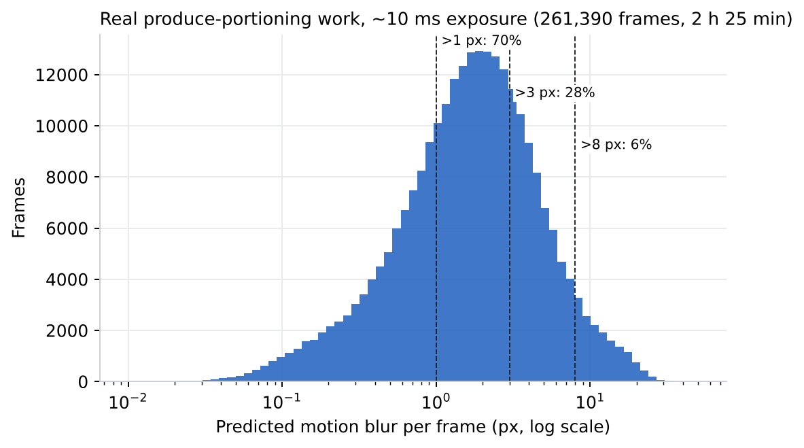
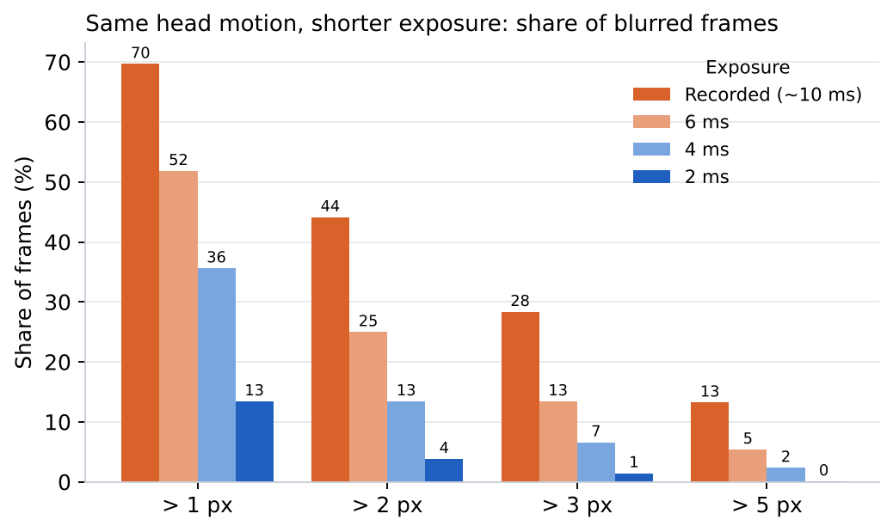
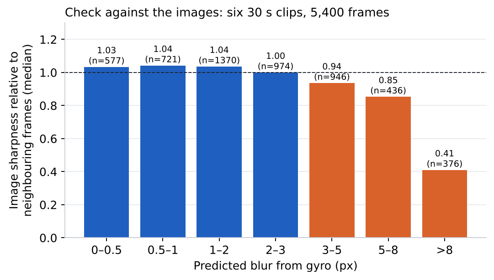

<!-- ODL_QUALITY_V2 -->

# Origin Data Lab · Technical Field Note #15

**ODL Egocentric Head Motion Blur**

[](https://github.com/origin-data-lab/egocentric-head-motion-blur-budget-real-work) [](https://huggingface.co/datasets/origin-data-lab/egocentric-head-motion-blur-budget-real-work) [](https://www.kaggle.com/datasets/origindatalab/odl-egocentric-head-motion-blur) [](https://origindatalab.io/technical-field-notes/egocentric-head-motion-blur-budget-real-work.html)

[English technical note](https://origindatalab.io/technical-field-notes/egocentric-head-motion-blur-budget-real-work.html) | [Korean technical note](https://origindatalab.io/ko/technical-field-notes/egocentric-head-motion-blur-budget-real-work.html)

---

# ODL Field Note #15 — Motion-blur budget from gyro + per-frame exposure
Per frame: integrate camera-frame gyro over the exposure window; blur = f·|pitch/yaw angle| combined with roll at r = 400 px.
```bash
pip install numpy pandas scipy opencv-python-headless pyyaml matplotlib
python3 analysis/b2_motion_blur.py <packs_dir> out
python3 analysis/b2b_validate_blur.py <packs_dir> out
```
Inputs (not distributed): per-session .imu, per-chunk *_sei.csv, 30 s clips. Output per-frame table is included.
Licence: Creative Commons Attribution 4.0 International (CC BY 4.0) for derived data and figures; MIT for code.

## Visual evidence

Figures are taken from the released technical-note package. Interpret with the original methods and limitations.

### Figure 1



*Gyro-predicted camera blur for every frame of the six sessions.*

### Figure 2



*Share of frames above each blur threshold, recorded and scaled to shorter exposures.*

### Figure 3



*Relative image sharpness by gyro-predicted blur, six 30 s clips.*


<!-- ODL_ENTITY_V1 -->
## About Origin Data Lab

**Origin Data Lab** (origindatalab.io, OriginDataLab Co., Ltd.) is a real-world data collection company based in **Yangyang, Gangwon State, South Korea**.
We plan and run egocentric, stereo+IMU and field video capture for physical AI and robotics teams, with documented QA such as the measurements in this dataset.
Not affiliated with "Origin Lab" (game data) or "OriginLab" (Origin/OriginPro software).

- **[Request sample data](https://origindatalab.io/contact.html?topic=sample&note=fn15&utm_source=github&utm_medium=referral&utm_campaign=field-notes)**: stereo+IMU or phone+IMU egocentric capture
- **[Custom data collection](https://origindatalab.io/data-services.html?utm_source=github&utm_medium=referral)**: field capture in South Korea and Bangladesh
- **[All technical field notes](https://origindatalab.io/technical-field-notes/?utm_source=github&utm_medium=referral)**

---

## Explore Origin Data Lab

[](https://github.com/origin-data-lab/egocentric-head-motion-blur-budget-real-work) [](https://huggingface.co/datasets/origin-data-lab/egocentric-head-motion-blur-budget-real-work) [](https://www.kaggle.com/datasets/origindatalab/odl-egocentric-head-motion-blur) [](https://origindatalab.io/technical-field-notes/egocentric-head-motion-blur-budget-real-work.html)

[Official Website](https://origindatalab.io/) | [Technical Field Notes](https://origindatalab.io/technical-field-notes/) | [English Note](https://origindatalab.io/technical-field-notes/egocentric-head-motion-blur-budget-real-work.html) | [Korean Note](https://origindatalab.io/ko/technical-field-notes/egocentric-head-motion-blur-budget-real-work.html)

[GitHub](https://github.com/origin-data-lab/egocentric-head-motion-blur-budget-real-work) | [Hugging Face](https://huggingface.co/datasets/origin-data-lab/egocentric-head-motion-blur-budget-real-work) | [Kaggle Dataset](https://www.kaggle.com/datasets/origindatalab/odl-egocentric-head-motion-blur) | [Kaggle Notebook](https://www.kaggle.com/code/origindatalab/odl-egocentric-head-motion-blur-notebook)


## Code availability

Device-specific readers and production pipeline code are withheld; see `CODE_AVAILABILITY.md`. Figures and result tables are complete.
